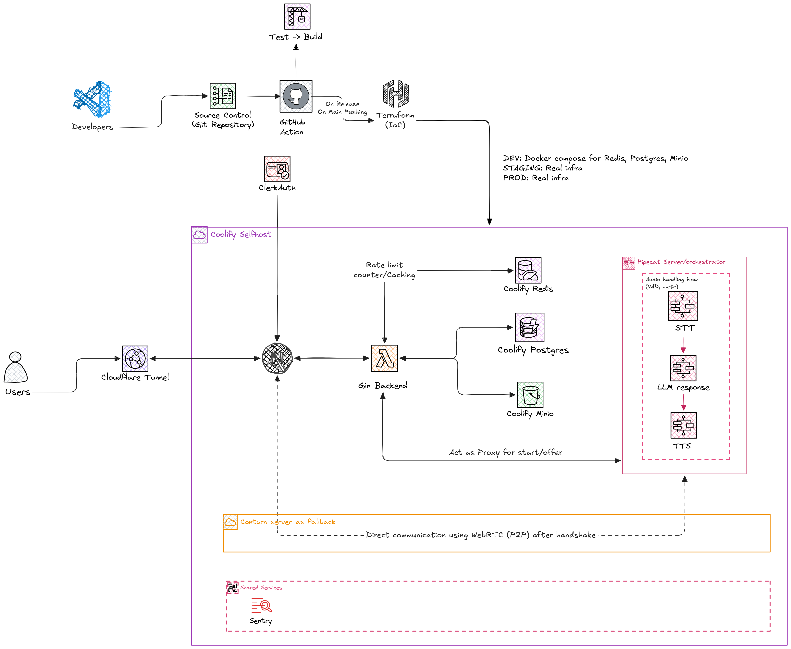
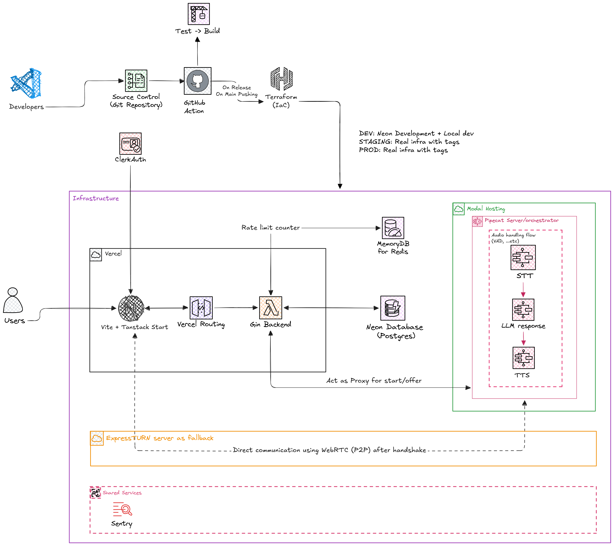
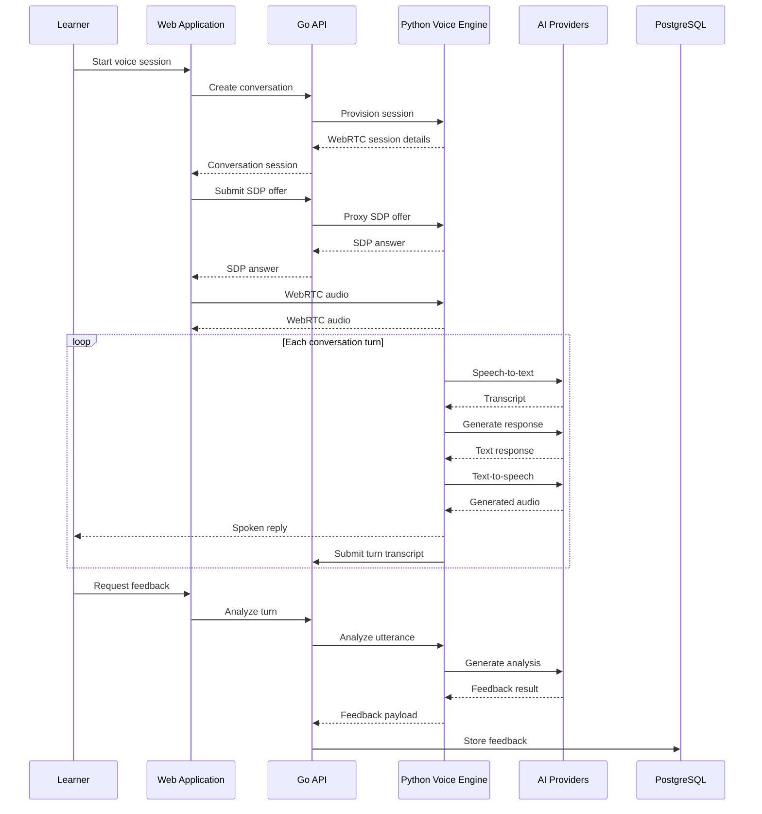

<div align="center">
  
</div>

<p align="center">
  
  
  
  
</p>

<p align="center">
  <a href="https://engflex.gianghp.site/"><strong>Live demo</strong></a>
  ·
  <a href="./apps/api/README.md">API docs</a>
  ·
  <a href="./apps/voice/README.md">Voice engine docs</a>
  ·
  <a href="./apps/web/README.md">Web docs</a>
  ·
  <a href="./tests/e2e/README.md">E2E docs</a>
</p>

> **Development status:** EngFlex is an actively developed graduation project. It brings together English lessons, dictation, shadowing, and real-time AI voice conversations under one learner profile and shared data layer.

## Introduction

EngFlex is an AI-powered English learning platform designed to connect structured practice with conversational learning.

Learners can practise through lessons and video content, speak with AI tutors in real time, receive feedback on individual utterances, save vocabulary, and track their learning progress. Rather than treating each activity as an isolated tool, EngFlex brings these workflows together around a shared learner profile.

The system uses a React-based web application, a Go API, and a separate Python voice engine. Real-time audio travels over WebRTC, while application data, conversation records, and learning progress are handled through the API and PostgreSQL.

### Highlights

- **Two complementary learning workflows:** structured exercises for deliberate practice and real-time conversations for spontaneous speaking.
- **Real-time AI conversation:** a speech pipeline combining speech recognition, an LLM, and speech synthesis.
- **Feedback without interrupting conversation:** utterance analysis is handled separately from the live conversational loop.
- **Shared learning context:** learner preferences, lessons, vocabulary, conversation records, and progress belong to one platform.
- **Self-hosted infrastructure:** a Coolify-based deployment managed through Terraform.

## Demo

Live application: **https://engflex.gianghp.site/**

<!-- Screenshots can be added under images/screenshots/ and referenced here. -->

## Key Features

| Feature | Description | Status |
|---------|-------------|--------|
| **Real-time AI voice chat** | Conversational speaking practice powered by Deepgram STT, an LLM, and Fish Audio TTS through Pipecat and WebRTC. | Implemented |
| **Free talk and roleplay** | Chat with the Flexi tutor or practise through fixed personas, with conversational boundaries and off-topic redirection. | Implemented |
| **On-demand conversation feedback** | Analyse individual turns for grammar issues, relevance, alternative expressions, and coaching suggestions without pausing the conversation. | Implemented |
| **Pronunciation scoring** | Acoustic pronunciation assessment through dedicated scoring endpoints, separate from the live conversational loop. | Implemented |
| **English lessons** | Practise reading and writing with reusable lesson content. | In development |
| **Lesson dictation workflows** | Dictation-based practice built on the lesson engine. | In development |
| **Video practice** | Curated video library with transcripts for dictation and shadowing practice. | In development |
| **Self-selected video practice** | Learner-supplied video content for dictation and shadowing exercises. | In development |
| **Vocabulary management** | Save words from lessons and conversations, and add words manually. | In development |
| **Spaced-repetition review** | Schedule and review saved vocabulary through SRS intervals. | In development |
| **Learning progress** | Track content completion from attempt records. | In development |
| **Prioritised progress list** | Order the content list by completion, surfacing unfinished activities first. | In development |
| **Personalized learner profile** | Configure English level, learning goals, interests, and available study time. | In development |
| **Profile-aware sessions** | Feed the learner profile into persona and conversation context selection. | In development |
| **Voice selection** | Select male or female TTS voices according to the configured voice persona. | Implemented |
| **Vietnamese and English UI** | Switch between Vietnamese and English, with Vietnamese as the default locale. | Implemented |
| **Usage limits & quotas** | Per-user caps on voice minutes and request volume. | Planned |
| **Premium plan** | Tiered subscription plans that unlock premium voices, personas, and higher limits. | Planned |
| **Payments** | Checkout and billing for the premium plan. | Planned |

## Architecture

EngFlex separates the web application, application API, and real-time voice processing into distinct components. This allows conversational audio processing to operate independently of ordinary application requests.

### System overview

<div align="center">
  
  <p><em>Self-hosted deployment architecture</em></p>
</div>

<div align="center">
  
  <p><em>Alternative cloud native architecture</em></p>
</div>


### Component responsibilities

| Component | Responsibility |
|-----------|----------------|
| **Web application** | Learning interface, authentication integration, lessons, vocabulary, progress, and voice-session interaction. |
| **Go API** | Application endpoints, business logic, authentication enforcement, persistence, and voice-session provisioning. |
| **PostgreSQL** | Durable storage for learner data, learning activities, conversations, and related records. |
| **Python voice engine** | Real-time speech processing, conversational orchestration, transcript capture, utterance analysis, and feedback generation. |
| **External AI providers** | Speech recognition, LLM responses, and text-to-speech generation. |
| **OpenPronounce** | Self-hosted pronunciation scoring service, alternative to AZURE pronunciation assessment. |
| **Coolify, Terraform and Cloudflare Tunnel** | Application deployment and infrastructure provisioning for the self-hosted environment. |

### Voice session lifecycle

A voice session has two distinct paths: session setup and real-time media processing. The API provisions the session, while the voice engine processes the audio. Go does not proxy the real-time audio stream.



## Engineering Decisions

The following design choices shape the system's separation of concerns, type safety, and deployment workflow.

### Separate application API and voice engine

The Go API owns application workflows and persistence, while the Python service owns speech processing and conversational orchestration.

This avoids coupling the main application backend to the implementation details of the speech pipeline. It also allows the voice service to use Python's AI ecosystem without moving ordinary application business logic into the voice runtime.

### WebRTC for real-time conversation

WebRTC carries real-time audio between the browser and voice engine. The Go API handles application requests and session provisioning rather than proxying the audio stream.

This separates latency-sensitive media processing from ordinary HTTP application traffic.

### Asynchronous utterance analysis

Conversation feedback is requested separately from the live conversational response. The API asks the voice engine to analyse a single turn and then stores the result, so the analysis never sits inside the critical conversational loop.

### SQL migrations as the schema source of truth

Goose SQL migrations define database schema changes. GORM is used for data access, but automatic schema migration is not the source of truth.

This makes schema changes explicit, reviewable, and version-controlled.

### Generated TypeScript API contracts

Go DTOs are the source of truth for generated TypeScript contracts through tygo. This reduces duplicated definitions between the Go backend and TypeScript frontend.

### Infrastructure as code

Terraform provisions the Coolify project, application configuration, supporting services, domains, and related infrastructure. Deployment commands combine infrastructure provisioning with migrations, artifact preparation, application deployments, and health checks.

## Tech Stack

| Layer | Technology | Purpose |
|-------|------------|---------|
| **Frontend** | React 19, TypeScript, TanStack Start | Application UI, routing, server interactions, and client state. |
| **UI and styling** | Shadcn/ui, Tailwind CSS | Reusable UI components and styling. |
| **Authentication** | Clerk | User authentication and session integration. |
| **Voice client** | Pipecat Client | Browser-side voice-session interaction. |
| **API backend** | Go, Gin, GORM | Application endpoints and business logic. |
| **Database** | PostgreSQL | Persistent application data. |
| **Database migrations** | Goose | Version-controlled SQL schema migrations. |
| **API contracts** | Tygo | Generate TypeScript contracts from Go DTOs. |
| **Speech pipeline** | Python, Pipecat, uv | Real-time speech orchestration and processing. |
| **Speech recognition** | Deepgram | Speech-to-text transcription. |
| **Language model** | OpenAI-compatible API | Conversational responses and feedback analysis. |
| **Text-to-speech** | Fish Audio | Voice generation and persona-based voice selection. |
| **Pronunciation assessment** | OpenPronounce | Optional acoustic pronunciation scoring. |
| **Internationalization** | Paraglide, inlang message format | Vietnamese and English interface localization. |
| **Mock generation** | Mockery v3 | Generated Go repository mocks. |
| **API documentation** | Swagger | Interactive API documentation. |
| **Deployment** | Docker, Coolify, Terraform, Cloudflare Tunnel | Containerized services and infrastructure provisioning. |
| **Observability** | Sentry | Error monitoring for application services. |

## Repository Structure

EngFlex is organized as a monorepo containing the frontend, Go API, Python voice engine, and shared API contracts.

```text
engflex/
├── apps/
│   ├── api/                          # Go application API
│   │   ├── cmd/server/
│   │   │   └── main.go               # Application entry point
│   │   ├── config/                   # Auth, database, logging, server, voice
│   │   ├── internal/
│   │   │   ├── common/               # Errors, response envelopes, enums, limits
│   │   │   ├── database/
│   │   │   │   ├── migrations/       # Goose SQL migrations
│   │   │   │   ├── models/           # GORM models
│   │   │   │   └── repositories/     # Data access and generated mocks
│   │   │   ├── logger/               # Structured logging
│   │   │   ├── modules/              # Feature-oriented application modules
│   │   │   │   ├── <domain>/         # conversations, lessons, scenarios, videos, vocabulary
│   │   │   │   │   ├── module.go     # Route registration
│   │   │   │   │   ├── controllers/  # HTTP handlers
│   │   │   │   │   ├── services/     # Business logic
│   │   │   │   │   └── dtos/         # Request and response DTOs
│   │   │   │   └── <dtos-only>/      # attempts, profiles (DTOs only; handlers pending)
│   │   │   ├── server/middleware/    # Auth, request ID, logging, recovery
│   │   │   └── utils/                # Mapping, pagination, IDs
│   │   ├── tygo.yaml                 # Go DTO to TypeScript configuration
│   │   ├── Makefile                  # Migrations, mocks, contracts, Swagger
│   │   └── README.md
│   │
│   ├── voice/                        # Python Pipecat voice engine
│   │   ├── src/
│   │   │   ├── app/                  # Runner routes and session schemas
│   │   │   ├── pipeline/             # STT, LLM, TTS factories and handlers
│   │   │   ├── transcript/           # Transcript capture and analysis
│   │   │   ├── clients/              # Callbacks to the Go API
│   │   │   ├── prompts.py            # Tutor and roleplay prompts
│   │   │   ├── bot.py                # Voice pipeline entry point
│   │   │   └── config.py             # Voice service configuration
│   │   ├── scripts/                  # Voice testing and utility scripts
│   │   ├── tests/                    # Voice-engine test suites
│   │   ├── pyproject.toml            # Python dependencies and tooling
│   │   └── README.md
│   │
│   └── web/                          # Web application
│       ├── src/
│       │   ├── routes/               # Application routes
│       │   ├── features/             # Feature-oriented UI modules
│       │   ├── components/           # Shared, layout, and UI components
│       │   ├── app/                  # Central route definitions
│       │   ├── lib/                  # API client, auth guards, utilities
│       │   └── paraglide/            # Generated localization output
│       ├── messages/{en,vi}/         # Localization source messages
│       ├── scripts/                  # Convention checks
│       └── README.md
│
├── packages/
│   └── contracts/                    # Generated TypeScript API contracts
│
├── infrastructure/
│   ├── environments/
│   │   └── selfhost/                 # Self-hosted environment configuration
│   └── modules/                      # Reusable infrastructure modules
│
├── images/                           # Architecture diagrams and screenshots
├── tests/
│   └── e2e/                          # Playwright end-to-end tests
├── .github/
│   └── workflows/                    # CI workflows
└── README.md
```

For implementation details, see the [API README](apps/api/README.md), [voice engine README](apps/voice/README.md), and [web application README](apps/web/README.md).

## Getting Started

This section describes how to run the development stack locally. The commands assume a Unix-like shell.

### Prerequisites

| Tool | Version | Purpose |
|------|---------|---------|
| [Go](https://go.dev/dl/) | >= 1.26 | API backend |
| [uv](https://docs.astral.sh/uv/) | Latest | Python dependencies and voice-engine runtime |
| [Node.js](https://nodejs.org/) | >= 20 | Web frontend |
| [pnpm](https://pnpm.io/) | >= 9 | Workspace management |
| [Docker](https://docs.docker.com/get-docker/) | Compose v2 | Local infrastructure and containerized services |
| [PostgreSQL](https://www.postgresql.org/) | 15+ | Database |
| [Goose](https://github.com/pressly/goose) | v3 | Database migrations |
| [mockery](https://vektra.github.io/mockery/) | v3 | Go mock generation |

The local voice workflow also requires credentials for the configured speech-recognition, language-model, and text-to-speech providers.

### 1. Install workspace dependencies

Run from the repository root:

```bash
pnpm install
```

### 2. Configure environment files

Create a local environment file for each application:

```bash
cp apps/api/.env.example apps/api/.env
cp apps/voice/.env.example apps/voice/.env
cp apps/web/.env.example apps/web/.env
```

Fill in the required values using the examples as a reference. At minimum, configure:

- Clerk keys for the API and web application.
- Database settings for PostgreSQL.
- Voice-engine URL and the shared internal service secret.
- API credentials and model configuration for STT, LLM, and TTS.
- Clerk publishable key for the web app. (The API base URL is a server-runtime setting, not a web `.env` value.)

The API requires `CLERK_SECRET_KEY` to start. The API's `VOICE_INTERNAL_SECRET` and the voice service's `INTERNAL_SECRET` must share the same value.

**Do not commit real API keys, authentication secrets, production environment files, or Terraform state.** Replace development-only credentials before exposing a deployment publicly.

### 3. Start local infrastructure

The API's Docker Compose configuration provides the supporting infrastructure.

```bash
cd apps/api
docker compose up -d postgres redis minio
```

This starts PostgreSQL, Redis, and MinIO. Ensure the database and object-storage settings in `apps/api/.env` match the Compose configuration.

### 4. Apply database migrations

Run Goose migrations from the API directory:

```bash
cd apps/api
make migration-up
```

Goose SQL migrations define the database schema. Do not use GORM `AutoMigrate` as an alternative schema-management mechanism.

### 5. Start the application services

Run each service in a separate terminal.

**Terminal 1 — Go API**

```bash
cd apps/api
go run ./cmd/server
```

The API listens on `http://localhost:8000` by default. Swagger UI is available at `/swagger`.

**Terminal 2 — Python voice engine**

```bash
cd apps/voice
uv run python src/bot.py
```

The voice engine listens on port `7860`, matching the API's default `VOICE_SERVICE_URL` (`http://localhost:7860`). Real-time audio is exchanged over WebRTC rather than being proxied through the Go API.

**Terminal 3 — Web application** (from the repository root)

```bash
pnpm --filter web dev
```

The web application is available at `http://localhost:3000` by default.

### 6. Optional: Enable pronunciation scoring

Pronunciation scoring requires the OpenPronounce model host. The initial container build can require several gigabytes of storage and a network connection.

From `apps/api`:

```bash
docker compose up -d openpronounce
make pronounce-warm
```

The warm-up command loads the acoustic model ahead of the first scoring request.

### 7. Optional: Seed lesson audio

After PostgreSQL migrations have completed and MinIO is available:

```bash
cd apps/api
make seed-audio
```

This generates lesson audio through TTS and stores the generated assets in MinIO.

### Local development ports

| Port | Service |
|------|---------|
| `3000` | Web application |
| `8000` | Go API |
| `7860` | Python voice engine |
| `8001` | OpenPronounce |
| `9000` | MinIO API |
| `9010` | MinIO console |
| `5777` | PostgreSQL host port, configurable through `DB_PORT` |
| `6379` | Redis |

Actual ports may differ depending on environment configuration and Docker Compose overrides.

## Configuration

Each application manages its own environment variables. Consult the corresponding `.env.example` for the complete list.

| Service | Key configuration |
|---------|-------------------|
| **API** — `apps/api` | `DATABASE_URL`, Clerk credentials, voice-engine URL, internal service secret |
| **Voice** — `apps/voice` | STT API key, LLM API key/base URL/model, TTS API key, voice model, male/female voice IDs, internal service secret |
| **Web** — `apps/web` | Clerk publishable/secret keys and Sentry DSN; the API base URL is a server-runtime setting (`API_INTERNAL_URL`), not a web `.env` value |
| **Infrastructure** | Terraform variables for Coolify, service configuration, domains, and provider integrations |

The web server uses `API_INTERNAL_URL` to locate the Go API when the default local address is not appropriate.

The browser uses the web application's same-origin application endpoints. The real-time audio connection is handled separately through the voice engine's WebRTC path.

See the individual application READMEs for service-specific configuration.

## Testing & CI

EngFlex uses a combination of automated tests, static analysis, formatting checks, type checking, and build verification across its Go, Python, and TypeScript components.

Run the following checks before submitting changes.

### Go API

```bash
cd apps/api

go test ./... -count=1
go vet ./...
test -z "$(gofmt -l internal/)"
```

### Python voice engine

```bash
cd apps/voice

uv run pytest -q
uv run ruff check src tests
```

### Web application

Run from the repository root:

```bash
pnpm --filter web compile:messages
pnpm --filter web check
pnpm --filter web typecheck
pnpm --filter web check:conventions
pnpm --filter web build
```

### End-to-end tests

Playwright E2E tests use their own environment configuration. See the [E2E testing README](tests/e2e/README.md).

```bash
pnpm --filter e2e test:e2e
```

End-to-end tests require the relevant services and test configuration to be available.

### CI workflow

The [CI workflow](.github/workflows/ci.yml) runs four jobs on every push and pull request — `api`, `voice`, `web`, and `contracts` (which fails on TypeScript contract drift). A `terraform` job (`fmt -check`, `init -backend=false`, `validate`) runs on `dev`/`main`, on pull requests targeting them, and on manual dispatch. The API job regenerates Swagger before vetting and testing, and the web job runs `compile:messages` before its checks. End-to-end tests are run locally and are not part of CI.

## Deployment

EngFlex's implemented deployment topology uses a single machine running Coolify, Docker, and Traefik. Terraform provisions the Coolify resources and application configuration, while deployment automation applies migrations, prepares the pronunciation artifact, deploys services, and checks health.

A managed-services alternative is retained as an architectural reference rather than the primary implemented deployment path.

### Deployment prerequisites

- A running Coolify instance accessible at the configured URL, such as `http://localhost:8000`.
- A Coolify API token with the permissions required to provision projects, databases, services, and applications.
- A domain whose DNS is hosted on Cloudflare (its root zone), together with a Cloudflare account ID, zone ID, and API token — required to create the Cloudflare Tunnel and publish the public hostname `<cloudflare_app_name>.<cloudflare_zone>` (for example, `engflex.gianghp.site`). The tunnel is optional (`cloudflare_enabled`, default `false`).
- Terraform >= 1.6.
- Docker.
- Goose v3, available at the configured executable path.
- Provider credentials and deployment-specific configuration stored outside version control.

### Bootstrap

Create the Terraform variable file:

```bash
cp infrastructure/environments/selfhost/terraform.tfvars.example \
   infrastructure/environments/selfhost/terraform.tfvars
```

Edit the file and supply the environment-specific values and required credentials.

Deploy the stack:

```bash
make deploy
```

The deployment workflow performs the following operations:

```text
Pronunciation artifact preparation
  └── Build and push the pinned OpenPronounce image before Terraform runs

terraform apply
  ├── Provision Coolify resources and application configuration
  ├── Configure PostgreSQL, Redis, MinIO, domains, and environment variables
  ├── Roll out the API, web, voice-engine, and pronunciation deployments
  │   (Terraform-owned deployments; no manual deploy triggers)
  └── Configure the voice engine with external ExpressTURN relay credentials

goose migrations
  └── Apply database schema changes

Health checks
  └── Verify external API/web endpoints and internal voice/pronunciation endpoints
```

The exact deployment targets and commands are defined in the repository's Makefiles and Terraform configuration.

### Seed deployment resources

After deployment:

```bash
make deploy-seed
```

This prepares the lesson-audio bucket, configures the required read access, and seeds lesson audio through TTS.

### Observability

Sentry projects and DSNs are provisioned through Terraform under `infrastructure/modules/sentry`. The deployment workflow injects DSNs into the relevant application environment, with web configuration applied during image build where required.

Provider authentication tokens should be supplied through the ignored Terraform variable file or another appropriate secret-management mechanism. Never put real provider tokens in the README or commit them to version control.

### Deployment details

For environment-specific variables, resource definitions, and operational changes, see the Terraform configuration under `infrastructure/environments/selfhost/` and the modules under `infrastructure/modules/`.

## API Development Commands

The following commands are available from `apps/api`:

```bash
cd apps/api

# Create a Goose migration
make migration-create name=...

# Apply or roll back migrations
make migration-up
make migration-down

# Regenerate Go mocks
make mocks

# Generate TypeScript contracts from Go DTOs
make contracts

# Regenerate Swagger documentation
make swagger
```

Migration changes should be reviewed before deployment. SQL migration files, rather than automatic ORM schema generation, remain the authoritative record of schema changes.

## Security & Limitations

EngFlex depends on external authentication and AI providers, and its development and deployment environments have different requirements.

- **Secret management:** Keep API credentials, Clerk secrets, internal service secrets, Terraform credentials, and production environment files out of version control.
- **Service authentication:** Configure the API and voice service with matching internal credentials, and verify authentication boundaries before exposing services publicly.
- **Object storage:** Review bucket policies and anonymous-read settings carefully. Public read access should be limited to assets intentionally published for learners.
- **External providers:** Voice conversations and generated audio depend on external STT, LLM, and TTS services. Availability, latency, usage limits, and costs depend on the selected providers and models.
- **Optional pronunciation service:** Pronunciation scoring requires the relevant model service and additional local resources.
- **Active development:** Features and deployment configuration may change. Check the current application code and environment examples before relying on a particular endpoint or operational behavior.

## Roadmap

Potential future improvements include:

- Session-end summaries and key takeaways.
- Progress trends, streaks, and more personalized recommendations.
- An administrative content-management interface.
- Usage limits and quotas, a premium plan with tiered entitlements, and payment checkout.
- Expanded end-to-end coverage for pronunciation assessment and additional feedback-persistence paths.
- Further improvements to voice-session reliability and observability.

The roadmap is a list of potential improvements, not a claim that these capabilities are already implemented.

## Team & Project Context

EngFlex is a three-person graduation project focused on integrating multiple English-learning workflows into one application.

The repository contains the web interface, application API, real-time voice engine, shared API contracts, and self-hosted deployment configuration. Individual contributions should be assessed from the actual code, implementation history, and technical ownership of each component.

## Documentation

| Resource | Description |
|----------|-------------|
| [API README](apps/api/README.md) | Go API, database access, migrations, and development commands |
| [Voice Engine README](apps/voice/README.md) | Python voice service and speech pipeline |
| [Web README](apps/web/README.md) | Frontend structure and development |
| [E2E Testing README](tests/e2e/README.md) | Playwright test setup and configuration |
| [Self-hosted Terraform environment](infrastructure/environments/selfhost/) | Deployment environment configuration |
| [Infrastructure modules](infrastructure/modules/) | Reusable infrastructure configuration |
